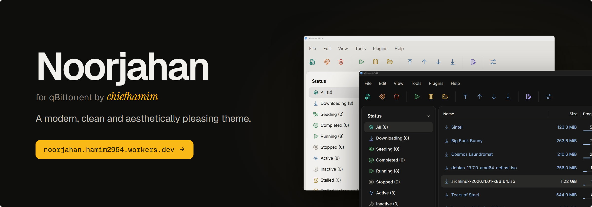
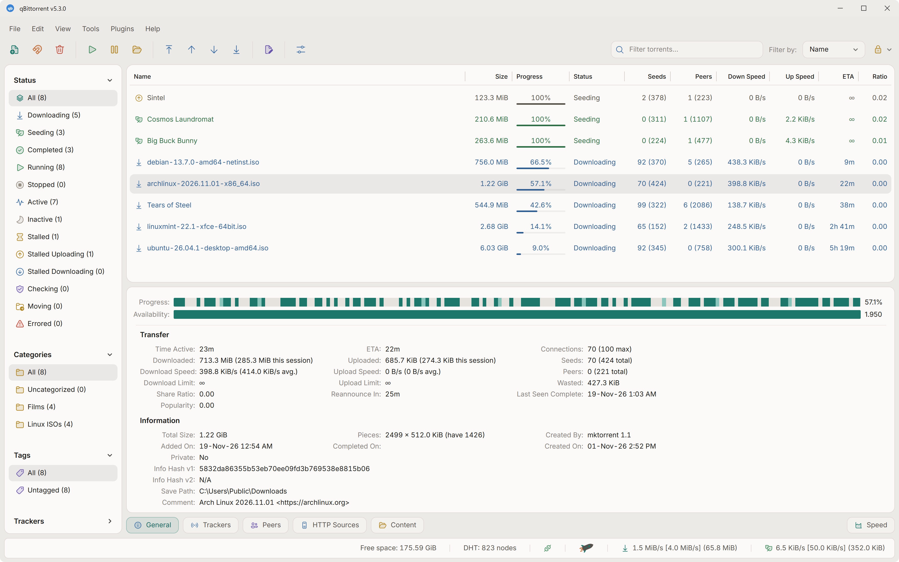
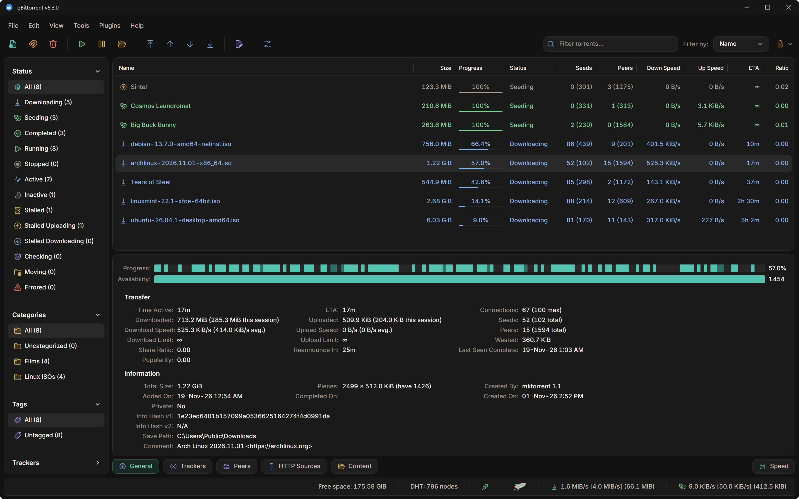
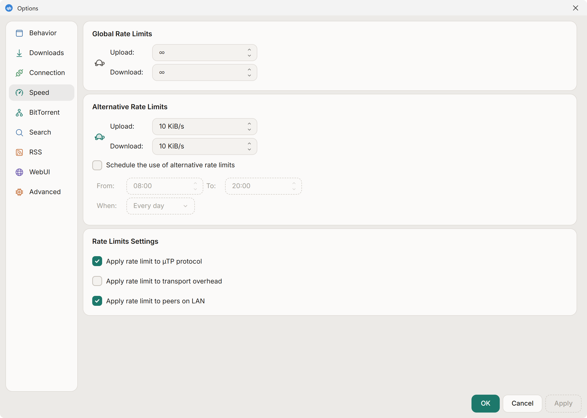
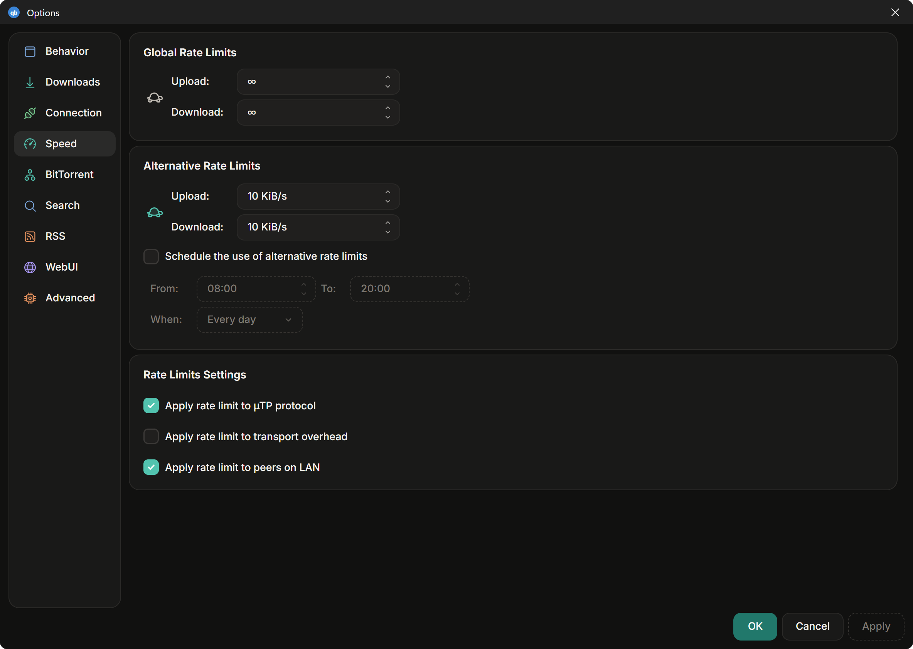
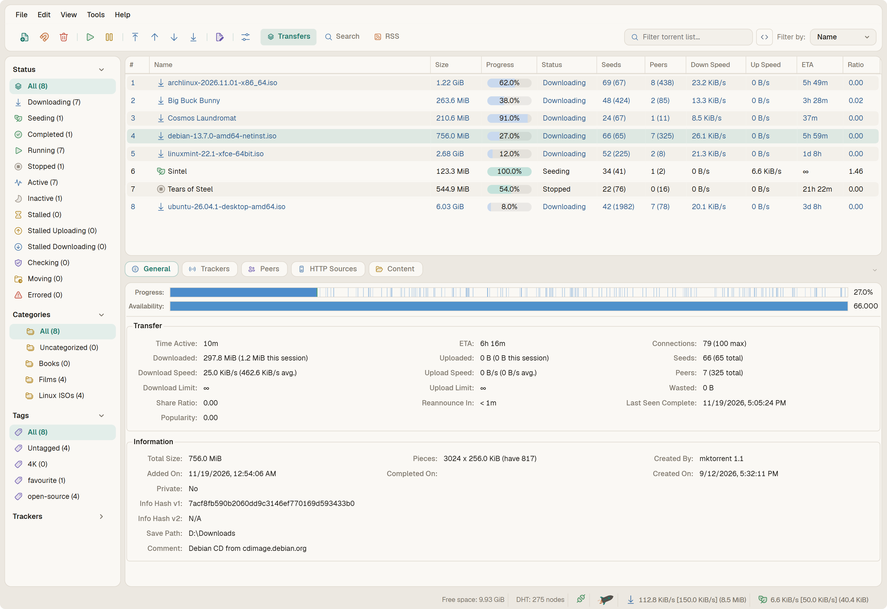
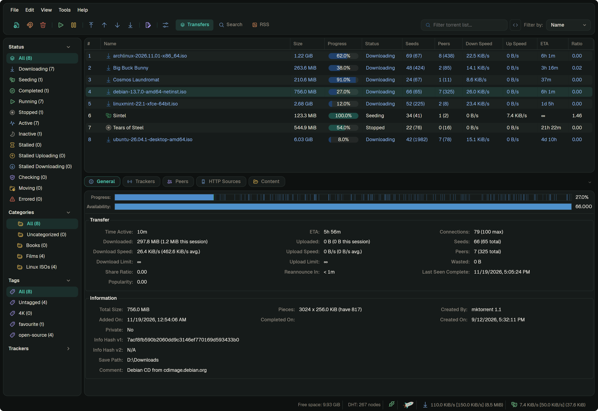

<div align="center">

<a href="https://noorjahan.hamim2964.workers.dev/"></a>

<br>

**A calmer, evenly spaced theme for qBittorrent.**<br>
Light and Dark · Regular and Compact · a matching Web UI

<br>

[](CHANGELOG.md)
[](https://www.qbittorrent.org)
[](https://noorjahan.hamim2964.workers.dev/#webui)
[](LICENSE)

<b><a href="https://noorjahan.hamim2964.workers.dev/#download">Download</a></b>
&nbsp;&nbsp;·&nbsp;&nbsp;
<a href="https://noorjahan.hamim2964.workers.dev/#tour">Live demo</a>
&nbsp;&nbsp;·&nbsp;&nbsp;
<a href="https://noorjahan.hamim2964.workers.dev/#compare">Before &amp; after</a>
&nbsp;&nbsp;·&nbsp;&nbsp;
<a href="CHANGELOG.md">Changelog</a>

</div>

<br>

<p align="center">
  <a href="https://ibb.co.com/album/y6b6dZ">
    <picture>
      <source media="(prefers-color-scheme: dark)" srcset=".github/assets/shots/02-pc-main-dark.png">
      
    </picture>
  </a>
</p>

<p align="center"><sub>The screenshot follows your GitHub theme. Switch it to see the other one.</sub></p>

<br>

## <picture><source media="(prefers-color-scheme: dark)" srcset=".github/assets/headings/what-it-changes-dark.svg"></picture>

**Warm stone surfaces, one teal accent, and 8 px of breathing room everywhere.** Colour only appears when something is happening.

<table>
<tr>
<td width="33%" valign="top"><b>Card layout</b><br><sub>Sidebar, transfer list, details and status bar sit on one even 8 px grid with soft corners.</sub></td>
<td width="33%" valign="top"><b>88 outline icons</b><br><sub>Recoloured Fluent UI icons across the toolbar, menus, dialogs and all 14 torrent states.</sub></td>
<td width="33%" valign="top"><b>Colour with meaning</b><br><sub>Blue downloads, green seeds, amber waits, red errors. Everything else stays neutral.</sub></td>
</tr>
<tr>
<td valign="top"><b>Quiet progress</b><br><sub>Slim underline bars that can follow each row's state colour, plus a rocket / turtle speed switch.</sub></td>
<td valign="top"><b>Regular or Compact</b><br><sub>Same look with 35 px rows and 9 pt text, so more torrents fit on screen.</sub></td>
<td valign="top"><b>Everywhere you look</b><br><sub>Main window, Options, Add Torrent, Torrent Creator and a Web UI that follows your system theme.</sub></td>
</tr>
</table>

## <picture><source media="(prefers-color-scheme: dark)" srcset=".github/assets/headings/gallery-dark.svg"></picture>

| Light | Dark |
| :---: | :---: |
| [](https://ibb.co.com/VWftgSbG) | [](https://ibb.co.com/0pzzVD7R) |
| [](https://ibb.co.com/svD50TPc) | [](https://ibb.co.com/Mk2DrCx8) |
| [](https://ibb.co.com/Z6BHZCKp) | [](https://ibb.co.com/RGVgLSKb) |

<p align="center"><sub>Click any shot for full size · <a href="https://ibb.co.com/album/y6b6dZ">Full album</a> · <a href="https://noorjahan.hamim2964.workers.dev/#compare">Interactive before &amp; after</a></sub></p>

## <picture><source media="(prefers-color-scheme: dark)" srcset=".github/assets/headings/install-dark.svg"></picture>

Everything is free on the **[website](https://noorjahan.hamim2964.workers.dev/#download)** and attached to every **[GitHub release](https://github.com/chiefhamim/noorjahan-qbittorrent/releases/latest)** with a `SHA256SUMS.txt`.

### <picture><source media="(prefers-color-scheme: dark)" srcset=".github/assets/headings/desktop-dark.svg"></picture>

**The easy way.** Download `Noorjahan-Setup.zip`, extract it and run **`Install Noorjahan.cmd`**. It installs all four themes and the [Inter](https://rsms.me/inter/) font for your user (no admin needed), backs up `qBittorrent.ini`, and can switch the theme on for you.

<details>
<summary><b>By hand</b></summary>
<br>

1. Download one `.qbtheme` (Light, Dark, Light Compact or Dark Compact) and keep it somewhere permanent, such as `%APPDATA%\qBittorrent\themes`.
2. In **Tools › Options › Behavior**, tick **Use custom UI theme** and pick the file.
3. On the same page, set **Style** to **`windows11`** (`windowsvista` on Windows 10), then restart qBittorrent.

The theme works without Inter and falls back to Segoe UI. Inter gives the exact spacing it was designed with.

</details>

> [!TIP]
> In **Behavior › Transfer List**, turn on **Make progress bars follow text colors** so every bar matches its torrent: blue while downloading, green while seeding.

### <picture><source media="(prefers-color-scheme: dark)" srcset=".github/assets/headings/web-ui-dark.svg"></picture>

1. Download `Noorjahan-WebUI.zip` and extract it.
2. In **Tools › Options › Web UI**, tick **Use alternative WebUI** and pick the `Noorjahan-WebUI` folder.
3. Hard-refresh the page (`Ctrl+F5`).

<details>
<summary><b>Updating the Web UI</b></summary>
<br>

From 1.2.4 the Web UI checks GitHub once a day and shows a small notice when a newer release is out. It never installs anything by itself, because qBittorrent can't let a web page write to its own folder. Turn the check off with **Stop checking** in the notice or **Help › Noorjahan update check**. The check is a plain request to `api.github.com`, so GitHub sees your IP address; no cookies or referrer are sent, and the setting stays in your browser.

To update, run the updater. It finds your `Noorjahan-WebUI` folder from qBittorrent's settings, checks the download's SHA-256, keeps the old folder as a backup and swaps in the new one. Reload the page; qBittorrent does not need a restart.

**Windows (PowerShell)**
```powershell
irm https://github.com/chiefhamim/noorjahan-qbittorrent/releases/latest/download/update-webui.ps1 -OutFile update-webui.ps1
powershell -ExecutionPolicy Bypass -File .\update-webui.ps1
```

**Linux / Raspberry Pi** (as the user that owns the folder)
```bash
curl -fsSLO https://github.com/chiefhamim/noorjahan-qbittorrent/releases/latest/download/update-webui.sh
bash update-webui.sh
```

Options: `-Path` / `--path` to name the folder, `-Check` / `--check` to only look, `-Yes` / `--yes` to skip the question, `-KeepBackups` / `--keep-backups` (default 3).

The desktop `.qbtheme` can't be swapped while qBittorrent runs, so it has no in-app notice: download the new file and restart qBittorrent.

</details>

<details>
<summary><b>Direct download links</b></summary>
<br>

Release files keep the same names every time, so the newest one is always at:

```
https://github.com/chiefhamim/noorjahan-qbittorrent/releases/latest/download/<file name>
```

`Noorjahan-Setup.zip` · `Noorjahan-Light.qbtheme` · `Noorjahan-Dark.qbtheme` · `Noorjahan-Light-Compact.qbtheme` · `Noorjahan-Dark-Compact.qbtheme` · `Noorjahan-WebUI.zip`

</details>

## <picture><source media="(prefers-color-scheme: dark)" srcset=".github/assets/headings/compatibility-dark.svg"></picture>

| | Versions | Platform |
| :-- | :-- | :-- |
| **Desktop theme** | qBittorrent 5.3 | Windows 10 & 11, with or without Inter |
| **Web UI** | qBittorrent 5.2.3 & 5.3.0 | Windows & Linux, tested on qBittorrent-nox on a Raspberry Pi 4 |

<details>
<summary><b>Build from source</b></summary>
<br>

The repo holds the theme source (`src/`), the Windows installer (`setup/`) and the Web UI fonts (`fonts/`). Install `PySide6-Essentials` (it ships `rcc.exe`) and run:

```bash
python src/build.py <path-to-rcc.exe>
```

This writes `build/light`, `build/dark`, `build/light-compact`, `build/dark-compact` and the four bundles in `dist/`.

</details>

## <picture><source media="(prefers-color-scheme: dark)" srcset=".github/assets/headings/credits-dark.svg"></picture>

Noorjahan's architecture, visual design, Qt stylesheet, icon recolouring, Web UI restyle, and installer are by [chiefhamim](https://github.com/chiefhamim) and are licensed under [GPL-2.0-or-later](LICENSE). Not affiliated with the qBittorrent project.

| Component | Source | License |
| :--- | :--- | :--- |
| Base app & Web UI | [qBittorrent](https://www.qbittorrent.org) | GPL-2.0-or-later |
| Icons (86 of 88) | [Fluent UI System Icons](https://github.com/microsoft/fluentui-system-icons) by Microsoft | MIT |
| Magnet icons (2 of 88) | [Lucide](https://lucide.dev) | ISC |
| Typefaces | [Inter](https://rsms.me/inter/) · [Geist](https://vercel.com/font) | SIL OFL 1.1 |

<br>

---

<p align="center">
  <sub>In loving memory of my mother, <strong>Noorjahan</strong> (نور جهان — <em>light of the world</em>) · 9 July 2026</sub>
</p>
